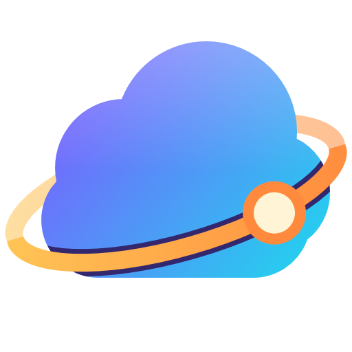

[English](README.md) | **한국어** · 📖 [사용자 가이드](docs/guide.ko.md) · ⬇️ [다운로드](https://github.com/windevase/nubis/releases/latest) · 🛡️ [VirusTotal 검사 결과 (릴리스 설명)](https://github.com/windevase/nubis/releases/latest)

# Nubis

### Handy Remote Client for All Engineers

SSH · RDP · SFTP 를 한 창에서, 클라우드 서버는 이미 목록에, Claude 는 터미널 바로 옆에 — 매일 하는 서버 작업을 편하고 안전하게 한곳에 모은 Windows 원격 접속 클라이언트.

> 이름: 라틴어 *nubis* = "구름의" + 우리말 "누비다" (여러 클라우드의 서버를 누비며 접속한다)

## 왜 만들었나

Nubis 는 제가 **편하고 안전하게** 쓰려고, 필요한 기능을 하나씩 직접 만든 앱입니다.

매일 SSH 클라이언트, 원격 데스크톱, SFTP 도구를 오가고, 서버 IP 를 찾으려고 클라우드 콘솔 네 곳을 열고, 에러 메시지를 따로 띄운 AI 채팅창에 복사해 붙이곤 했습니다. 그러면서 서버 계정이 평문 설정 파일에 남아 있거나, AI 가 운영 서버에서 무엇을 실행하는지 제대로 확인하지 못하는 것도 늘 마음에 걸렸습니다.

그래서 편한 것은 한곳에 모으고, 위험한 것은 반드시 제 확인을 거치게 만들었습니다. 계정과 서버 목록은 암호화해 저장하고, Claude 가 서버를 바꾸는 작업은 전부 승인 창과 감사 로그를 거치며, 서버의 호스트키가 바뀌면 항상 경고합니다. 지금은 제가 매일 쓰는 도구입니다.

Linux 와 Windows 서버가 섞여 있고 여러 클라우드에 흩어져 있는 환경이라면, 같은 번거로움과 걱정을 덜어 줄 수 있을 겁니다.

## 이런 걸 합니다

**🖥️ 모든 접속을 한 창에서**
SSH 터미널, RDP 데스크톱, 로컬 PowerShell 을 탭으로 나란히 엽니다. 검색창에 `user@host` 만 입력하면 바로 접속됩니다.

**☁️ 클라우드 서버가 이미 목록에**
이 PC 에 저장된 인증 프로필(AWS 프로필 · Tencent 자격 증명 · GCP ADC · Azure CLI)로 AWS · Tencent Cloud · Google Cloud · Azure 의 서버를 프로필별로 가져옵니다. 계속 동기화되어 이름과 IP 는 갱신되고, 직접 바꾼 설정은 그대로 남습니다.

**✦ 터미널 바로 옆의 Claude**
내장 Claude 패널은 지금 보고 있는 탭을 압니다. "이 에러 뭐야?", "Production 그룹 디스크 확인해줘", "이 서버 추가하고 운영 계정 연결해줘" 처럼 말하면 됩니다. 서버를 바꾸는 작업은 모두 승인을 거치고 감사 로그에 남으며, Claude 는 저장된 비밀번호와 키를 읽을 수 없습니다.

**📁 따라다니는 SFTP**
SSH 를 열면 파일 패널이 함께 열리고, 터미널의 현재 폴더를 따라갑니다. 탐색기와 끌어다 놓기로 주고받고, VS Code 로 연 파일은 저장할 때마다 서버에 바로 올라갑니다.

**🔑 계정은 Vault 하나로**
여러 서버가 같이 쓰는 사용자명 · 비밀번호 · SSH 키를 한 번 저장하고 호스트마다 고릅니다. 비밀번호를 한곳에서 바꾸면 모든 호스트에 적용됩니다.

**🔒 기본이 안전하게**
모든 데이터는 이 PC 에서 Windows DPAPI 로 암호화되어, 다른 PC 나 다른 Windows 계정에서는 열리지 않습니다. 사용 통계 수집은 없습니다. 선택 사항인 시작 화면 로그인(GitHub · Google · Microsoft)을 켜면 계정마다 데이터를 나눕니다.

**🌐 한국어 · 영어**
처음 실행할 때 언어를 고르고, Settings 에서 언제든 바꿉니다. Claude 도 같은 언어로 답합니다.

## 시작하기

1. [다운로드](https://github.com/windevase/nubis/releases/latest)에서 포터블 zip 을 받아 풀고 `Nubis.exe` 를 실행합니다 — 설치 프로그램도 .NET 설치도 필요 없습니다 (Windows 10 / 11, 64비트).
2. 언어를 고르고 **시작하기** 카드를 따라갑니다: 서버 추가, 클라우드 가져오기, 또는 Claude 에게 안내를 받으세요.
3. Claude 패널을 쓰려면 [Claude Code CLI](https://docs.claude.com/claude-code) 를 설치합니다: `npm install -g @anthropic-ai/claude-code`

모든 기능과 설정, 각 설정이 어떻게 동작하는지는 **[사용자 가이드](docs/guide.ko.md)** 에 있습니다.

## 만든 재료

WPF (.NET 10) · [SSH.NET](https://github.com/sshnet/SSH.NET) · WebView2 위의 [xterm.js](https://xtermjs.org/) · Windows 내장 원격 데스크톱 엔진(`mstscax`) · 내장 MCP 서버로 연결한 [Claude Code](https://docs.claude.com/claude-code).

```powershell
.\build.ps1            # Debug 빌드 후 실행
.\build.ps1 test       # 자동 테스트
.\build.ps1 publish    # publish\Nubis.exe + dist\ 포터블 zip
```

## 코드 서명 정책

Free code signing provided by [SignPath.io](https://about.signpath.io), certificate by [SignPath Foundation](https://signpath.org).

> SignPath Foundation 에 무료 코드 서명을 신청했다. 승인 전까지 배포 파일은 서명되지 않으므로, 릴리스 페이지의 `SHA256SUMS.txt` 로 SHA256 을 확인한다.

- 배포 파일은 이 저장소의 소스로 [GitHub Actions](.github/workflows/build.yml) 만 만든다 (`v*` 태그를 푸시하면 테스트·빌드 후 릴리스). 로컬에서 만든 파일은 서명하지 않는다.
- 커밋·리뷰: [windevase](https://github.com/windevase)
- 서명 승인: [windevase](https://github.com/windevase)

## 개인정보

이 프로그램은 사용자(또는 설치·운영하는 사람)가 요청하지 않는 한 어떤 정보도 다른 네트워크 시스템으로 보내지 않는다.

Nubis 가 연결하는 곳은 사용자가 설정한 곳뿐이다: 접속하는 서버, 추가한 클라우드 프로필의 API (이 PC 에 저장된 인증 프로필 사용), 시작 화면 로그인에 설정한 OAuth 제공자, 그리고 Claude 패널을 열면 이 PC 에 설치된 Claude Code CLI (사용자 본인 계정으로 Anthropic 과 통신). 사용 통계·분석·업데이트 확인은 없다. 모든 데이터는 `%APPDATA%\Nubis` 에 Windows DPAPI 로 암호화되어 남는다.

## 라이선스

[MIT License](LICENSE) — 개인·상업 용도 관계없이 자유롭게 사용·수정·배포할 수 있다 (저작권 고지와 라이선스 문구 유지).

포함·사용한 오픈소스 구성요소와 테마 출처는 [THIRD-PARTY-NOTICES.md](THIRD-PARTY-NOTICES.md) 참고.
