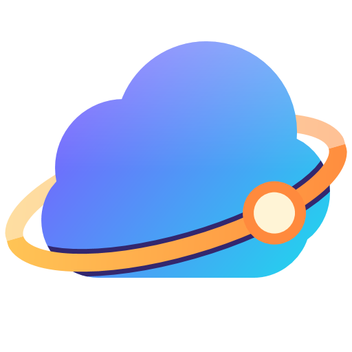
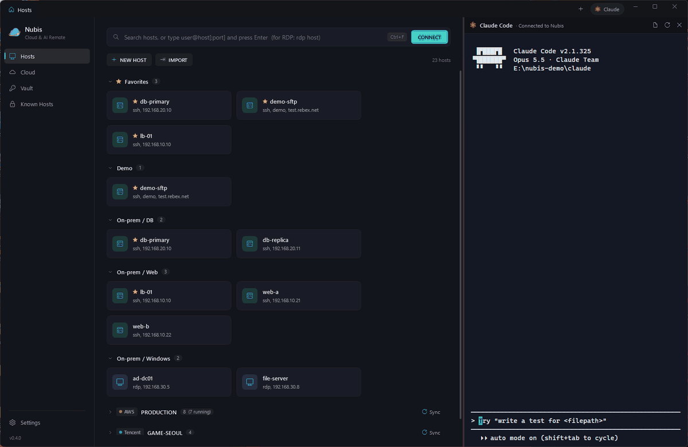
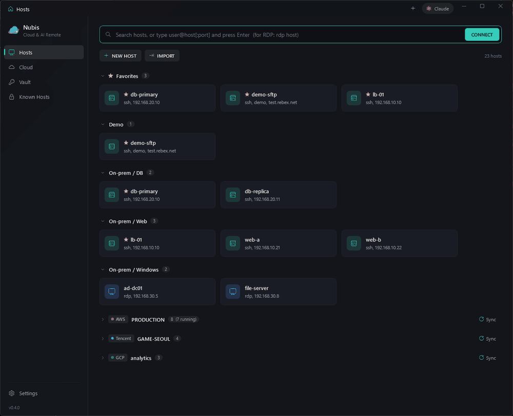
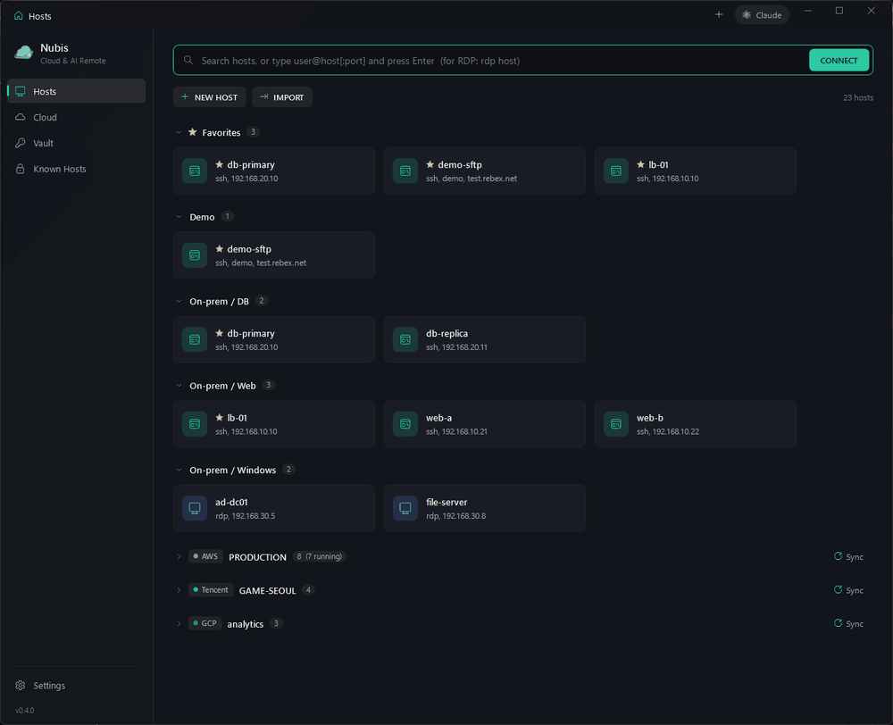
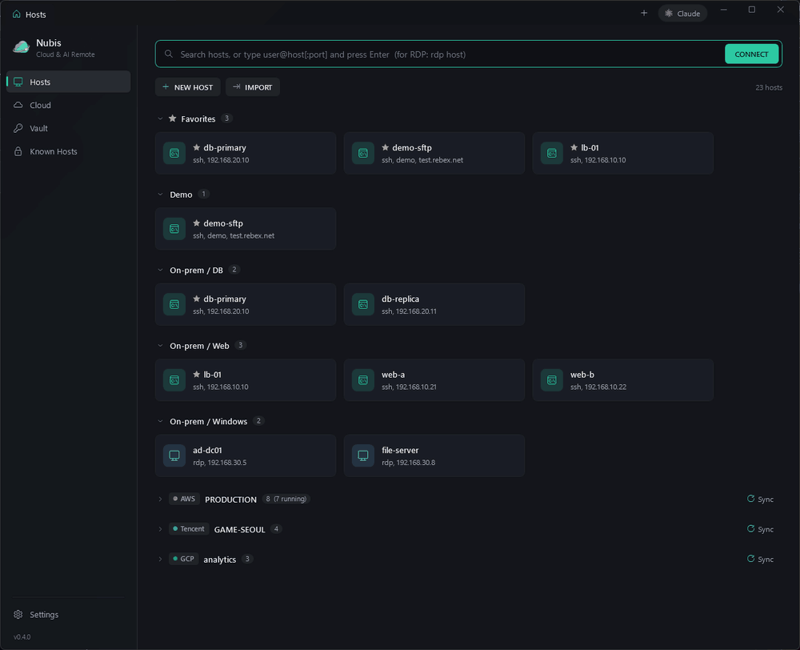
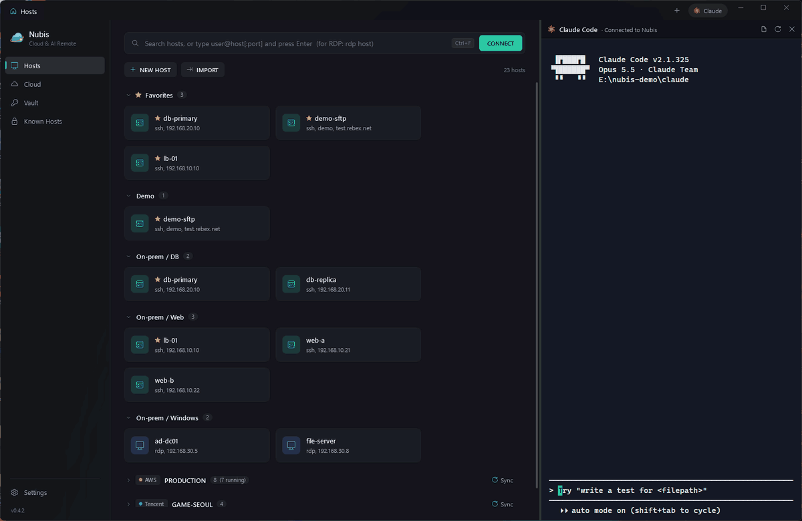
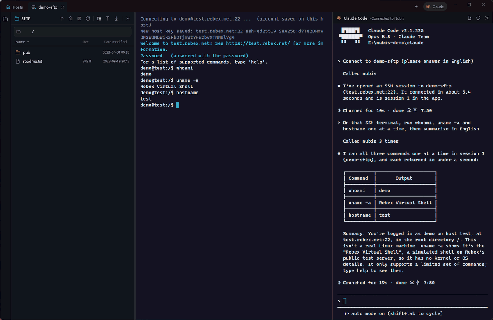
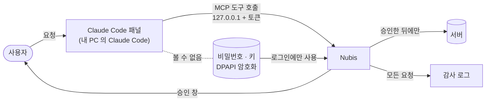

[English](README.md) | **한국어** · 📖 [사용자 가이드](docs/guide.ko.md) · ⬇️ [다운로드](https://github.com/windevase/nubis/releases/latest) · 🛡️ [VirusTotal 검사 결과 (릴리스 설명)](https://github.com/windevase/nubis/releases/latest)

# Nubis

### Handy Remote Client for All Engineers

SSH · RDP · SFTP 를 한 창에서, 클라우드 서버는 이미 목록에, Claude 는 터미널 바로 옆에 — 매일 하는 서버 작업을 편하고 안전하게 한곳에 모은 Windows 원격 접속 클라이언트.



> 이름: 라틴어 *nubis* = "구름의" + 우리말 "누비다" (여러 클라우드의 서버를 누비며 접속한다)

## 왜 만들었나

Nubis 는 제가 **편하고 안전하게** 쓰려고, 필요한 기능을 하나씩 직접 만든 앱입니다.

매일 SSH 클라이언트, 원격 데스크톱, SFTP 도구를 오가고, 서버 IP 를 찾으려고 클라우드 콘솔 네 곳을 열고, 에러 메시지를 따로 띄운 AI 채팅창에 복사해 붙이곤 했습니다. 그러면서 서버 계정이 평문 설정 파일에 남아 있거나, AI 가 운영 서버에서 무엇을 실행하는지 제대로 확인하지 못하는 것도 늘 마음에 걸렸습니다.

그래서 편한 것은 한곳에 모으고, 위험한 것은 반드시 제 확인을 거치게 만들었습니다. 계정과 서버 목록은 암호화해 저장하고, Claude 가 서버를 바꾸는 작업은 전부 승인 창과 감사 로그를 거치며, 서버의 호스트키가 바뀌면 항상 경고합니다. 지금은 제가 매일 쓰는 도구입니다.

Linux 와 Windows 서버가 섞여 있고 여러 클라우드에 흩어져 있는 환경이라면, 같은 번거로움과 걱정을 덜어 줄 수 있을 겁니다.

## 이런 걸 합니다

**🖥️ 모든 접속을 한 창에서**
SSH 터미널, RDP 데스크톱, 로컬 PowerShell 을 탭으로 나란히 엽니다. 검색창에 `user@host` 만 입력하면 바로 접속되고, `Ctrl+K` 를 누르고 이름·IP·열린 탭·동작 이름 일부를 입력해 방향키로 고른 뒤 Enter 로 실행합니다. 즐겨찾기와 최근 접속 호스트가 맨 위에 있습니다. 탭은 순서 바꾸기·이름 바꾸기·다시 연결·한꺼번에 닫기가 되고, 방금 닫은 탭은 `Ctrl+Shift+R` 로 다시 엽니다. 서버 두 대의 로그를 같이 보거나 같은 서버에 셸 두 개를 띄우려면 탭 우클릭 → **오른쪽에 나란히 보기** 로 다른 탭을 고르면 한 화면에 나란히 보이고, 가운데 경계선을 끌어 크기를 바꾸며, 클릭한 쪽에 입력됩니다. 복사·붙여넣기는 Windows Terminal 방식(`Ctrl+C`/`Ctrl+V`)이나 PuTTY · mRemoteNG 방식(선택하면 복사, 우클릭으로 붙여넣기) 중 익숙한 쪽으로 고를 수 있습니다. ssh-agent 와 `~/.ssh` 기본 키, `known_hosts`, OTP·Push 2단계 인증(답 기억하기), 점프 서버(ProxyJump)까지 OpenSSH 처럼 동작하고, RDP 는 RD 게이트웨이를 포함해 mstsc 기본 설정을 따릅니다. Entra ID(Azure AD) 가입 PC 도 `AzureAD\사용자@도메인` 으로 로그인하고 그 호스트만 NLA 를 끄면 접속됩니다. SSH 호스트에 포트 포워딩(`ssh -L`)을 저장해 두면 탭이 연결될 때마다 서버 뒤의 DB·관리 페이지가 이 PC 의 `127.0.0.1` 포트로 열리고(탭의 SSH 연결을 그대로 써서 다시 로그인·OTP 없음) 탭을 닫으면 닫힙니다. 탭의 ⇄ 버튼에서 열린 포워딩을 보고, 주소를 복사하고, 웹 포트는 브라우저로 열고, 그 탭에만 임시 포워딩을 추가합니다. 옆의 차트 버튼을 누르면 그 탭에 실시간 서버 모니터가 켜져 터미널 위에 CPU · 메모리 · 네트워크 수신/송신이 짧은 그래프와 함께 보입니다 — 탭이 보이는 동안 같은 연결로 2초마다 읽고, 기록은 남기지 않습니다(Linux 서버).



**☁️ 클라우드 서버가 이미 목록에**
이 PC 에 저장된 인증 프로필(AWS 프로필 · Tencent 자격 증명 · GCP ADC · Azure CLI · OCI `~/.oci/config` 프로필 — `oci session authenticate` 브라우저 로그인 또는 API 키)로 AWS · Tencent Cloud · Google Cloud · Azure · Oracle Cloud(OCI) 의 서버를 프로필별로 가져옵니다. 필요할 때·앱을 켤 때·몇 분마다 동기화되어 이름과 IP 는 갱신되고, 직접 바꾼 설정은 그대로 남습니다. 그룹을 우클릭하면 그 그룹 서버 전체를 공인/사설 IP 로 바꾸거나 Vault 계정 하나를 한 번에 지정하고, 카드를 `Ctrl`/`Shift`+클릭으로 골라 계정·사용자명·포트·그룹·접속 IP·즐겨찾기·태그를 한꺼번에 편집할 수도 있습니다. 호스트마다 `키=값` 태그(`용도=웹`, `env=prod` 등)를 자유롭게 붙일 수 있고, 카드에 보이고 검색되며 클라우드 동기화는 태그를 건드리지 않습니다.



**⎈ 쿠버네티스 클러스터, 인증은 클러스터마다 따로**
Kubernetes 페이지는 클러스터마다 kubeconfig 를 그 클러스터 하나만 담도록 잘라 DPAPI 로 암호화해 따로 저장하므로, 다른 클러스터의 토큰이 섞이지 않습니다. `~/.kube/config`(또는 `KUBECONFIG` 의 여러 파일을 kubectl 규칙대로 합친 것)·파일·붙여 넣은 YAML 에서 context 를 골라 가져오거나(원본 파일은 바꾸지 않음), 이미 추가한 클라우드 프로필 중 원하는 것만 골라 EKS · GKE · AKS · OKE · TKE 클러스터를 찾으면(리전은 지정하지 않아도 전 리전을 자동으로 확인) 고른 프로필은 이후 동기화 때 함께 갱신됩니다. 클러스터를 열면 왼쪽에 파드·디플로이먼트·서비스·노드 목록(네임스페이스 선택, 이름 검색, 5초 자동 새로고침), 오른쪽에 `kubectl`·`k9s`·`helm` 이 그 클러스터를 가리키는 PowerShell 이 열립니다. 파드는 더블클릭하면 셸, 우클릭하면 로그·이전 컨테이너 로그·describe·YAML·삭제이고, 디플로이먼트는 `rollout restart` 로 다시 시작합니다. 파드·디플로이먼트·서비스를 우클릭해 **포트 포워딩** 할 수 있습니다: 알려진 포트를 고르면 로컬 포트를 제안하고(같은 번호, 쓰이면 빈 포트), 127.0.0.1 에만 열리며, 터미널 위 목록(`127.0.0.1:8080 → svc/web:80`)에서 주소 복사·브라우저로 열기·중지·다시 시작을 하고, 탭을 닫으면 멈춥니다. 복호화한 kubeconfig 는 탭이나 `kubectl` 이 실행되는 동안에만 현재 Windows 계정만 읽을 수 있는 임시 파일로 둡니다. PC 에 `kubectl` 이 있어야 하고, 클라우드 클러스터는 해당 클라우드의 CLI 나 인증 플러그인도 필요합니다.

**🏢 온프레미스 서버도 한 번에**
`IMPORT` 로 이미 가진 서버 목록을 그대로 가져옵니다 — 엑셀·CSV 붙여넣기(한글·영문 머리글 자동 인식), `~/.ssh/config`(`Include`·`ProxyJump` 포함), mRemoteNG `confCons.xml`(폴더가 그룹으로), Ansible 인벤토리(INI·YAML), Microsoft Entra Domain Services 를 포함한 Active Directory(LDAPS 우선, 현재 Windows 로그인 또는 입력한 계정), 그리고 원격 데스크톱 `.rdp` 파일(여러 개 고르거나 호스트 목록에 끌어다 놓기 — 주소·포트·사용자명(`AzureAD\user@domain` 포함)·RD 게이트웨이·NLA 설정을 옮김). 미리보기에서 등록할 서버를 고르고 SSH · RDP 용 Vault 계정을 정하면 되고, 이미 있는 호스트는 알아서 걸러져 두 번 등록되지 않습니다. 비밀번호는 어떤 출처에서도 가져오지 않습니다.



**✦ 터미널 바로 옆의 Claude**
내장 Claude 패널은 지금 보고 있는 탭을 압니다. "이 에러 뭐야?", "Production 그룹 디스크 확인해줘", "이 서버 추가하고 운영 계정 연결해줘" 처럼 말하면 됩니다. 서버를 바꾸는 작업은 모두 승인을 거치고 감사 로그에 남으며, Claude 는 저장된 비밀번호와 키를 읽을 수 없습니다. 호스트·그룹·탭·SFTP 파일·클라우드 프로필·Vault 계정·포트 포워딩·쿠버네티스 클러스터·설정처럼 손으로 하던 일도 Claude 에게 맡길 수 있습니다 — 서버·계정·데이터를 바꾸는 일은 여전히 승인을 기다리고(즐겨찾기 같은 화면 정리는 기록만 남김), 비밀번호는 직접 입력합니다. OTP·Push 인증을 요구하는 서버는 이미 로그인한 탭의 연결로 명령을 실행해 다시 인증하지 않습니다. RDP 탭에서는 Claude 가 원격 화면을 보고 직접 클릭·입력합니다(PowerShell 을 열어 서비스 상태 확인 등) — 3389 만 열린 서버에 유용하고, 연결마다 한 번 승인하면 10분 동안, 글자 입력은 매번 승인하며, 탭 메뉴에서 언제든 멈출 수 있고, 실제 마우스 커서는 움직이지 않습니다(Claude 가 입력하는 동안에는 포커스가 RDP 로 가고 사용자 키 입력은 막힘). "우리 서버 다 가져와줘" 라고 하면 Claude 가 이 PC 의 환경(클라우드 CLI 프로필, `~/.ssh/config`, mRemoteNG, 도메인)을 살펴 클라우드 프로필을 추가하고, 로그인이 필요하면 로그인 창을 띄우고, 온프레미스 목록을 가져옵니다 — 먼저 미리보기를 보여 주고, 등록 전에 한 번 승인을 받습니다.

 

**📁 따라다니는 SFTP**
SSH 를 열면 파일 패널이 같은 연결 위에 함께 열리고(OTP 서버도 다시 인증하지 않음), 터미널의 현재 폴더와 사용자까지 따라갑니다 — 터미널에서 `sudo su -` 하면 패널도 root 권한으로 바뀝니다. 탐색기와 끌어다 놓기로 주고받고, VS Code 로 연 파일은 저장할 때마다 서버에 바로 올라갑니다.

**🔑 계정은 Vault 하나로**
여러 서버가 같이 쓰는 사용자명 · 비밀번호 · SSH 키를 한 번 저장합니다. SSH · RDP 기본 계정을 정해 두면 계정을 따로 정하지 않은 모든 호스트가 쓰고, 그룹 우클릭으로 그룹 전체에, 또는 호스트마다 고를 수 있습니다. 비밀번호를 한곳에서 바꾸면 모든 호스트에 적용됩니다.

**🔒 기본이 안전하게**
모든 데이터는 이 PC 에서 Windows DPAPI 로 암호화되어, 다른 PC 나 다른 Windows 계정에서는 열리지 않습니다. 사용 통계 수집은 없습니다. 선택 사항인 시작 화면 로그인(GitHub · Google · Microsoft)을 켜면 계정마다 데이터를 나눕니다.

**🪶 가볍고 Windows 답게**
Mica 를 입힌 Windows 11 Fluent 디자인(Windows 10 에서는 단색 어두운 창)이고, 작업 결과는 토스트로 잠깐 알려 줍니다. 호스트 목록·명령 팔레트·대화상자는 키보드로 다룰 수 있고, 포커스가 눈에 보이며 스크린 리더가 읽을 이름도 붙어 있습니다. 가볍게 유지하는 데도 신경 썼습니다 — 가만히 있을 때 움직이는 애니메이션이 없고, 탭을 닫으면 그 탭이 쓰던 자원을 모두 돌려놓습니다.

**🌐 한국어 · 영어**
처음 실행할 때 언어를 고르고, Settings 에서 언제든 바꿉니다. Claude 도 같은 언어로 답합니다.

## Claude 를 어떻게 통제하나

운영 서버 옆에 AI 를 두려면 무엇을 하는지 보고 멈출 수 있어야 합니다. Claude 패널은 이렇게 연결되어 있습니다.



- **Claude 는 비밀번호와 키를 받지 않습니다.** 서버 로그인은 Nubis 가 직접 하고, 도구 결과와 로그에는 비밀번호가 들어가지 않습니다.
- **서버·계정·데이터에 영향을 주는 동작은 모두 승인 창을 거치고** `claude_audit.log` 에 남습니다. 예외는 읽기 전용 명령뿐이며, Settings 에서 자동 승인을 켰을 때만 해당합니다 (이때도 기록은 남습니다).
- **`kubectl` 도 같은 규칙을 따릅니다.** Claude 의 `run_kubectl` 은 승인 창을 거치고 기록에 남으며, 읽기 전용 자동 승인은 `get`·`describe`·`logs`·`top` 같은 명령만 해당하고 Secret 조회는 빠집니다. 클러스터와 인증은 Nubis 에 저장된 값으로 고정되어 `--kubeconfig`·`--server`·`--token` 같은 옵션과 `kubectl config view`, 로컬 파일을 읽고 쓰는 옵션, kubectl 플러그인은 거부합니다.
- **샌드박스가 아니라 안전장치입니다.** 패널은 사용자와 같은 Windows 계정으로 실행되므로, Nubis 는 계정 파일 읽기·DPAPI 복호화·자기 설정 수정을 막는 Claude Code 거부 규칙도 함께 넘깁니다. 실수와 프롬프트 주입을 막는 용도이고, 실제 보호는 암호화와 승인 창입니다.
- **저장된 호스트키와 다르면 항상 경고합니다** (사용자 접속이든 Claude 의 명령이든).

## 시작하기

1. [다운로드](https://github.com/windevase/nubis/releases/latest)에서 `Nubis-<버전>-portable-win-x64.zip` 을 받아 풀고 `Nubis` 폴더의 `Nubis.exe` 를 실행합니다 — 앱 DLL 이 exe 옆에 함께 있으니 폴더째로 두세요. 설치 프로그램도 .NET 설치도 필요 없습니다: Windows 10 / 11 64비트, 그리고 Windows 에 보통 이미 들어 있는 Microsoft Edge WebView2 런타임이면 됩니다.
2. 언어를 고르고 **시작하기** 카드를 따라갑니다: 서버 추가, 클라우드 가져오기, 또는 Claude 에게 안내를 받으세요.
3. Claude 패널을 쓰려면 [Claude Code CLI](https://docs.claude.com/claude-code) 를 설치합니다: `npm install -g @anthropic-ai/claude-code`

모든 기능과 설정, 각 설정이 어떻게 동작하는지는 **[사용자 가이드](docs/guide.ko.md)** 에 있습니다.

## 만든 재료

WPF (.NET 10) · [SSH.NET](https://github.com/sshnet/SSH.NET) (조금 고친 빌드, `third_party/SSH.NET` 참고) · WebView2 위의 [xterm.js](https://xtermjs.org/) · Windows 내장 원격 데스크톱 엔진(`mstscax`) · AWS SDK for .NET·Azure.Identity·Google.Apis.Auth(클라우드 인증) · PC 에 설치된 `kubectl`(쿠버네티스) · YamlDotNet·System.DirectoryServices.Protocols(Ansible·Active Directory 가져오기) · 내장 MCP 서버로 연결한 [Claude Code](https://docs.claude.com/claude-code).

```powershell
.\build.ps1            # Debug 빌드 후 실행
.\build.ps1 test       # 자동 테스트
.\build.ps1 publish    # publish\ (Nubis.exe + DLL, .NET 포함) + dist\ 포터블 zip
```

## 코드 서명 정책

Free code signing provided by [SignPath.io](https://about.signpath.io), certificate by [SignPath Foundation](https://signpath.org).

> SignPath Foundation 에 무료 코드 서명을 신청했다. 승인 전까지 배포 파일은 서명되지 않으므로, 릴리스 페이지의 `SHA256SUMS.txt` 로 SHA256 을 확인한다.

- 배포 파일은 이 저장소의 소스로 [GitHub Actions](.github/workflows/build.yml) 만 만든다 (`v*` 태그를 푸시하면 테스트·빌드 후 릴리스). 로컬에서 만든 파일은 서명하지 않는다.
- 커밋·리뷰: [windevase](https://github.com/windevase)
- 서명 승인: [windevase](https://github.com/windevase)

## 개인정보

이 프로그램은 사용자(또는 설치·운영하는 사람)가 요청하지 않는 한 어떤 정보도 다른 네트워크 시스템으로 보내지 않는다 (아래의 익명 새 버전 확인은 예외이며 끌 수 있다).

Nubis 가 연결하는 곳은 사용자가 설정한 곳뿐이다: 접속하는 서버, 추가한 쿠버네티스 클러스터 (이 PC 의 `kubectl` 로), 추가한 클라우드 프로필의 API (이 PC 에 저장된 인증 프로필 사용), 시작 화면 로그인에 설정한 OAuth 제공자, 그리고 Claude 패널을 열면 이 PC 에 설치된 Claude Code CLI (사용자 본인 계정으로 Anthropic 과 통신). 또 새 버전을 알려 주려고 하루 한 번 GitHub API (`api.github.com`) 에서 최신 릴리스 번호를 조회한다 — 사용자 정보를 보내지 않는 익명 요청이며 (여느 웹 요청처럼 GitHub 에는 IP 주소만 보인다) Settings → **새 버전 알림** 에서 끌 수 있다. 사용 통계·분석은 없다. 모든 데이터는 `%APPDATA%\Nubis` 에 Windows DPAPI 로 암호화되어 남는다.

## 라이선스

[MIT License](LICENSE) — 개인·상업 용도 관계없이 자유롭게 사용·수정·배포할 수 있다 (저작권 고지와 라이선스 문구 유지).

포함·사용한 오픈소스 구성요소와 테마 출처는 [THIRD-PARTY-NOTICES.md](THIRD-PARTY-NOTICES.md), 접근성 현황과 알려진 한계는 [ACCESSIBILITY.md](ACCESSIBILITY.md) 참고.
