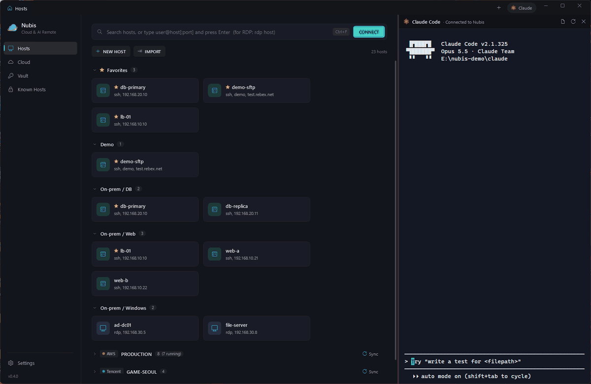
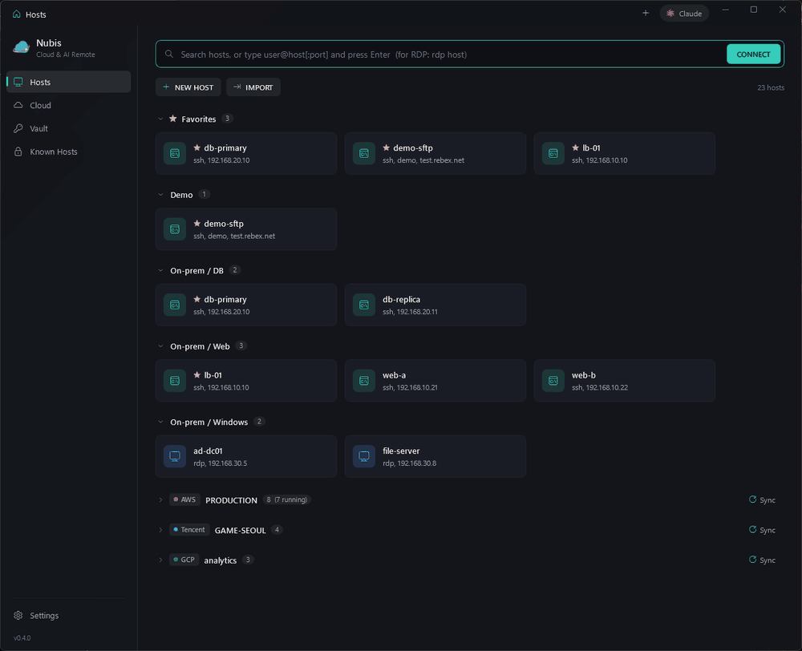
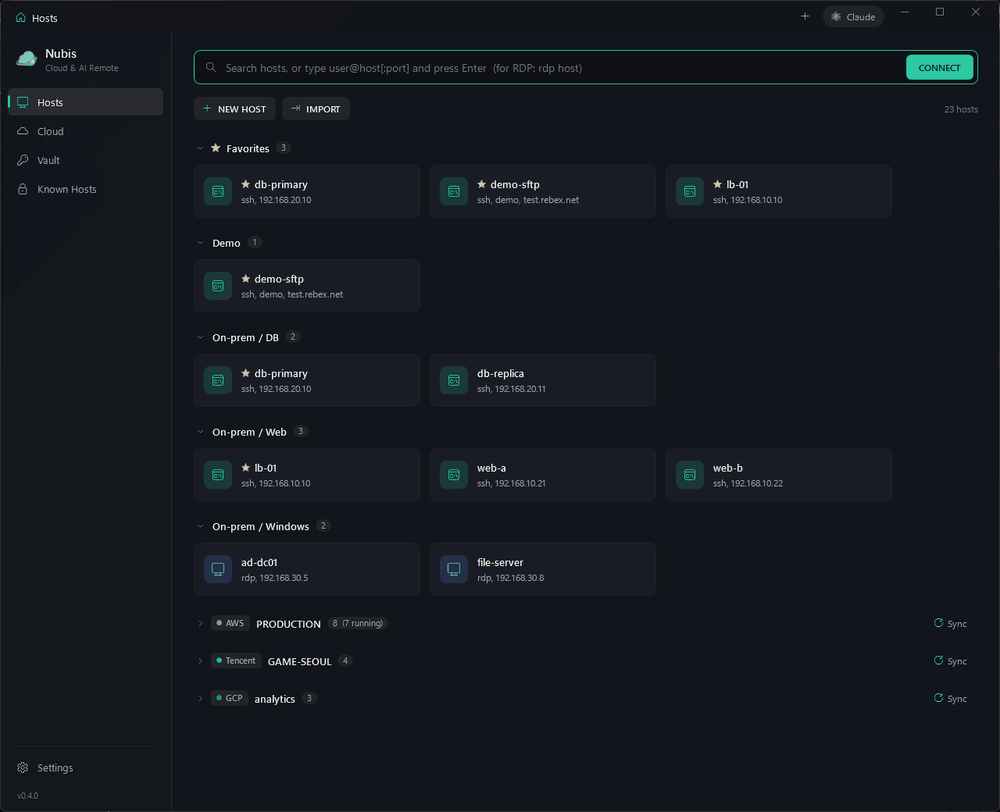
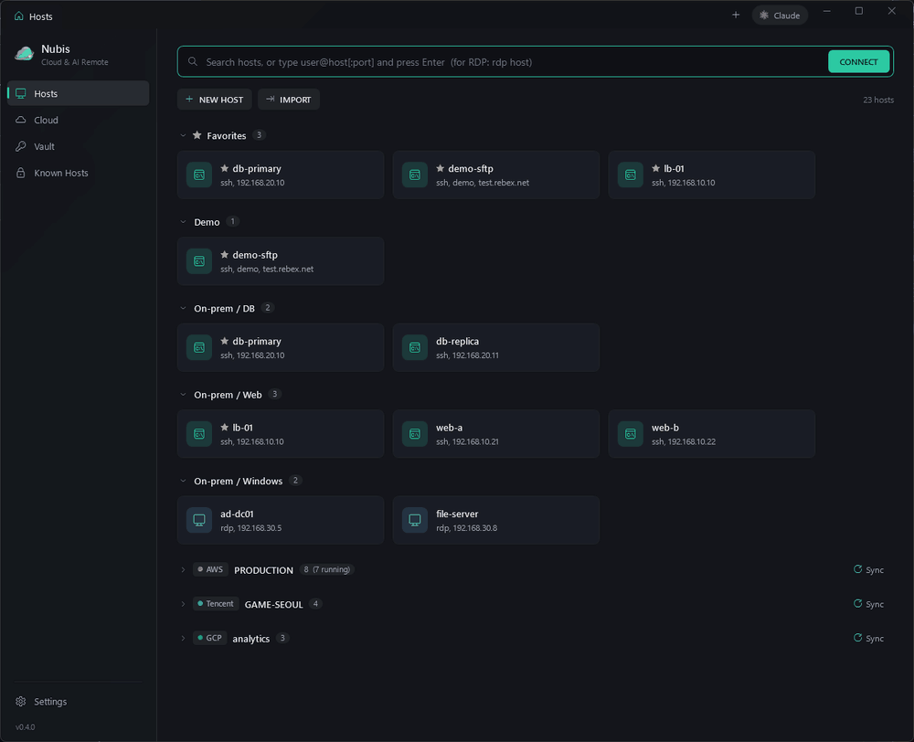
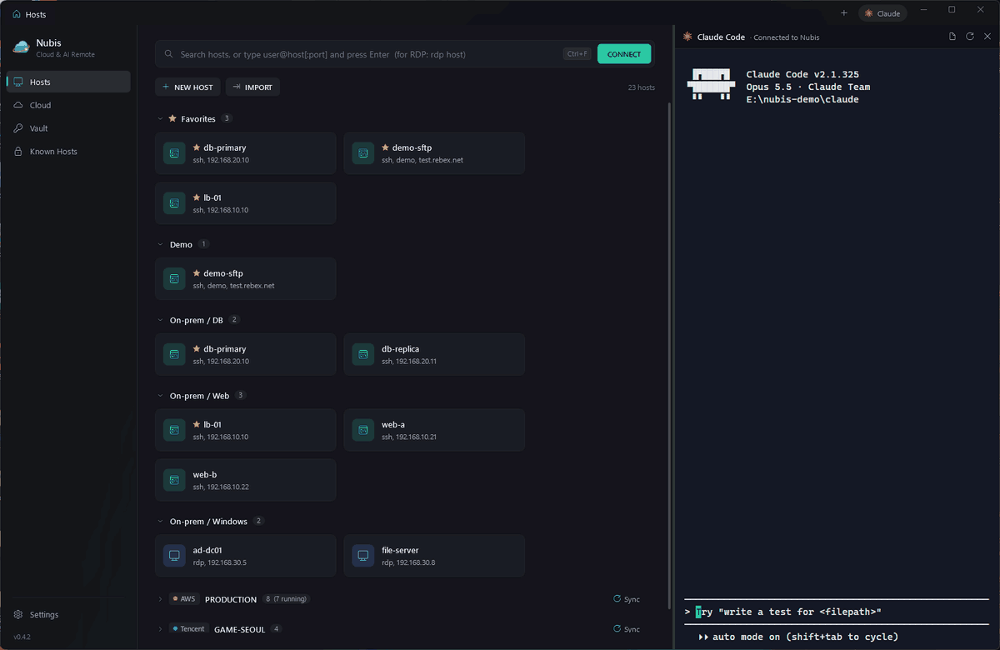
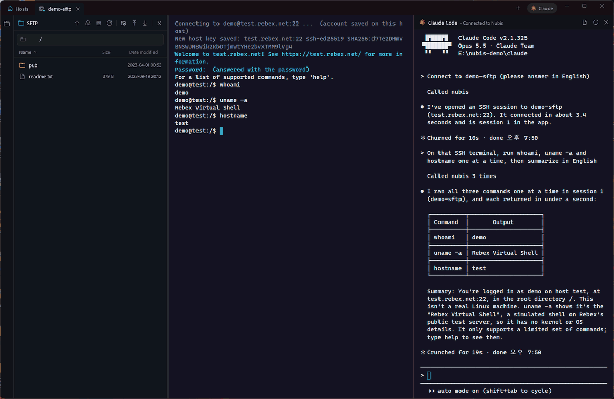
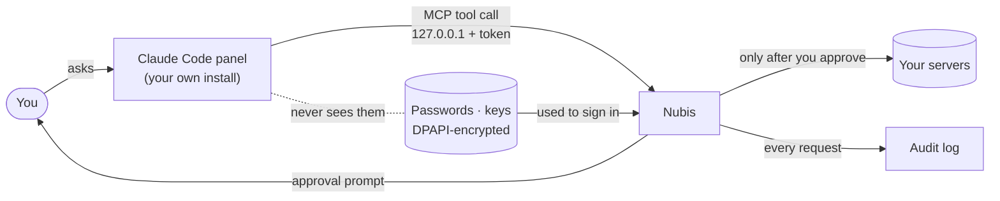

**English** | [한국어](README.ko.md) · 📖 [User Guide](docs/guide.md) · ⬇️ [Download](https://github.com/windevase/nubis/releases/latest) · 🛡️ [VirusTotal scan (in release notes)](https://github.com/windevase/nubis/releases/latest)

# Nubis

### Handy Remote Client for All Engineers

SSH, RDP and SFTP in one window, your cloud servers already in the list, and Claude sitting right next to the terminal — a Windows remote client that keeps everyday server work comfortable, safe and in one place.



> Name: Latin *nubis* = "of the cloud" + Korean *nubida* ("to roam through") — roaming the servers of many clouds.

## Why Nubis

I built Nubis for myself, adding the features I needed one at a time, so that I could work with my servers **comfortably and safely**.

Day to day I was switching between an SSH client, the Remote Desktop app, an SFTP tool, four cloud consoles to look up server IPs, and a separate AI chat I kept pasting error messages into. And it always bothered me that server accounts sat in plain-text config files, and that I could not really see what an AI was about to run on a production server.

So I brought the convenient parts into one place and made sure the risky parts always go through me. Accounts and server lists are stored encrypted, every change Claude makes to a server goes through an approval prompt and an audit log, and a changed host key always triggers a warning. Today it is the tool I use every day.

If your work looks like that too — a mix of Linux and Windows servers, spread across a few clouds — Nubis may save you the same trouble and the same worries.

## What it does

**🖥️ One window for every connection**
SSH terminals, RDP desktops and local PowerShell open side by side as tabs. Type `user@host` in the search box and you are connected — or press `Ctrl+K` and type part of a name, an IP, an open tab or an action, pick with the arrow keys and hit Enter. Favorites and recent hosts sit at the top. Tabs can be reordered, renamed, reconnected and closed in bulk, and `Ctrl+Shift+R` reopens the one you just closed. Copy and paste the way you're used to — Windows Terminal style `Ctrl+C`/`Ctrl+V`, or PuTTY / mRemoteNG style (select to copy, right-click to paste). It behaves like OpenSSH where it matters — ssh-agent and `~/.ssh` default keys, `known_hosts`, OTP / push MFA prompts (with remembered answers), jump hosts (ProxyJump) — and RDP follows your mstsc defaults, RD Gateway included. Entra ID (Azure AD) joined PCs work too: sign in as `AzureAD\user@domain` and turn NLA off for that host.



**☁️ Your cloud servers, already in the list**
Import servers from AWS, Tencent Cloud, Google Cloud, Azure and Oracle Cloud (OCI), profile by profile, using the credential profiles already saved on your PC (AWS profiles · Tencent credentials · GCP ADC · Azure CLI · OCI `~/.oci/config` profiles, signed in through the browser with `oci session authenticate` or with an API key). They stay in sync (on demand, at startup or every few minutes) — names and IPs update, your own changes stay. Right-click a group to switch all of its servers to public or private IPs, or to assign one Vault account to every server in it — or `Ctrl`/`Shift`+click any cards and bulk-edit their account, username, port, group, IP choice, favorite or tags at once. Give any host your own `key=value` tags (say `purpose=web` or `env=prod`): they show on the card, are searchable, and cloud sync never touches them.



**⎈ Kubernetes clusters, each with its own credentials**
The Kubernetes page keeps every cluster's kubeconfig separately — cut down to that one cluster and encrypted with DPAPI, so one cluster's token never mixes with another's. Import contexts from `~/.kube/config` (or every file in `KUBECONFIG`, merged the way kubectl does), a file or pasted YAML (the original file is not changed), or pick which of your cloud profiles to search for EKS, GKE, AKS, OKE and TKE clusters (every region is checked automatically, no region to set); the picked profiles then update their clusters with every sync. Opening a cluster shows pods, deployments, services and nodes on the left (namespace filter, search, 5-second auto refresh) and a PowerShell on the right where `kubectl`, `k9s` and `helm` point at that cluster. Double-click a pod for a shell; right-click it for logs, previous-container logs, describe, YAML or delete, and restart a deployment with `rollout restart`. The decrypted kubeconfig exists only as a temporary file readable by your Windows account while a tab or `kubectl` is running. Needs `kubectl` on your PC (plus the cloud's CLI or auth plugin for cloud clusters).

**🏢 On-prem servers in one go**
`IMPORT` reads the server lists you already have — paste rows from Excel or CSV (Korean or English headers are recognized), `~/.ssh/config` (with `Include` and `ProxyJump`), mRemoteNG `confCons.xml` (folders become groups), Ansible inventories (INI or YAML), Active Directory, including Microsoft Entra Domain Services (LDAPS first, your current Windows sign-in or an account you enter), and Remote Desktop `.rdp` files — pick several or drag them onto the host list; address, port, username (`AzureAD\user@domain` too), RD Gateway and NLA settings carry over. Preview everything, pick what to add, choose a Vault account for SSH and for RDP, and existing hosts are detected so nothing is added twice. Passwords are never imported.



**✦ Claude, right next to the terminal**
The built-in Claude panel sees the tab you are looking at. Ask "what is this error?", "check disk usage on the Production group" or "add this server and link the ops account". Anything that changes a server waits for your approval and is written to an audit log, and Claude cannot read your saved passwords or keys. Claude can also do what you do by hand: hosts, groups, tabs, SFTP files, cloud profiles, Vault accounts, Kubernetes clusters and settings. Anything that touches a server, an account or your data still waits for your approval (view-only tweaks like favorites are just logged), and passwords stay with you. On servers that ask for OTP or push approval, Claude runs commands over the tab you already signed in to — no second prompt. On an RDP tab Claude can work the remote desktop itself — it reads the screen, then clicks and types (say, open PowerShell and check a service) — handy when only 3389 is open; you approve once per connection for 10 minutes, typed text every time, can stop it from the tab menu at any moment, and your mouse cursor doesn't move (while Claude is typing, focus visits the RDP control and your own key presses are held back). Ask "bring in all our servers" and Claude looks at what this PC has (cloud CLI profiles, `~/.ssh/config`, mRemoteNG, the domain), adds cloud profiles, starts a cloud sign-in when one is needed, and imports on-prem lists — showing a preview first and asking once before anything is added.

 

**📁 SFTP that follows you**
The file panel opens with every SSH session on the same connection (no second sign-in, even with OTP) and follows the terminal's current folder — and its user too: `sudo su -` in the terminal and the panel browses as root. Drag files in and out of Explorer. Open a file in VS Code, and every save goes straight back to the server.

**🔑 Accounts in one Vault**
Save shared usernames, passwords and SSH keys once. Set a default account for SSH and for RDP and every host without its own account uses it, assign one to a whole group with a right-click, or pick one per host. Change a password in one place and every host uses it.

**🔒 Safe by default**
All data is encrypted with Windows DPAPI on your PC, so it will not open on another PC or under another Windows account. No telemetry. An optional sign-in screen (GitHub · Google · Microsoft) keeps each account's data separate.

**🪶 Light and native**
A Windows 11 Fluent look with Mica (a plain dark window on Windows 10), short toast notifications for results, and keyboard use throughout — the host list, the command palette and the dialogs, with visible focus and screen-reader names. Kept light on purpose: nothing animates while you're idle, and closing a tab releases everything it held.

**🌐 Korean and English**
Choose the language on first launch and switch it any time in Settings. Claude answers in the same language.

## How Claude is kept in check

Putting an AI next to production servers only works if you can see and stop what it does. This is how the Claude panel is wired:



- **Claude never gets your passwords or keys.** Nubis signs in to servers itself; tool results and logs never contain a password.
- **Anything that touches a server, an account or your data waits for your approval** and is written to `claude_audit.log`. The only exception is read-only commands, and only if you turn on auto-approval for them in Settings (they are still logged).
- **`kubectl` follows the same rules.** Claude's `run_kubectl` asks for approval and is logged; read-only auto-approval covers only commands such as `get`, `describe`, `logs` and `top`, never reading Secrets. The cluster and credentials are fixed to the ones saved in Nubis, so options like `--kubeconfig`, `--server` or `--token` are refused, and so are `kubectl config view`, options that read or write local files, and kubectl plugins.
- **A safety net, not a sandbox.** The panel runs under your Windows account, so Nubis also passes Claude Code deny rules that block reading the account files, DPAPI decryption and editing its own settings. They catch mistakes and prompt injection; the real protection is the encryption and the approval prompt.
- **A changed host key always triggers a warning**, for you and for Claude.

## Get started

1. [Download](https://github.com/windevase/nubis/releases/latest) `Nubis-<version>-portable-win-x64.zip`, extract it and run `Nubis.exe` in the `Nubis` folder — keep the folder together (the app's DLLs sit next to the exe). No installer and no .NET install needed: Windows 10 / 11, 64-bit, with the Microsoft Edge WebView2 Runtime that Windows normally already has.
2. Pick a language, then follow the **Get started** cards: add a server, import a cloud, or ask Claude to walk you through it.
3. For the Claude panel, install the [Claude Code CLI](https://docs.claude.com/claude-code): `npm install -g @anthropic-ai/claude-code`.

Everything else — every feature, every setting and how it behaves — is in the **[User Guide](docs/guide.md)**.

## Built with

WPF on .NET 10 · [SSH.NET](https://github.com/sshnet/SSH.NET) (a small patched build, see `third_party/SSH.NET`) · [xterm.js](https://xtermjs.org/) on WebView2 · the Windows built-in Remote Desktop engine (`mstscax`) · AWS SDK for .NET, Azure.Identity and Google.Apis.Auth for cloud sign-in · the `kubectl` installed on your PC for Kubernetes · YamlDotNet and System.DirectoryServices.Protocols for Ansible and Active Directory import · [Claude Code](https://docs.claude.com/claude-code) through a built-in MCP server.

```powershell
.\build.ps1            # Debug build, then run
.\build.ps1 test       # automated tests
.\build.ps1 publish    # publish\ (Nubis.exe + DLLs, self-contained) + dist\ portable zip
```

## Code signing policy

Free code signing provided by [SignPath.io](https://about.signpath.io), certificate by [SignPath Foundation](https://signpath.org).

> Signing through SignPath Foundation has been applied for. Until it is approved, release builds are unsigned — check the SHA256 in `SHA256SUMS.txt` on the release page.

- Release binaries are built only by [GitHub Actions](.github/workflows/build.yml) from this repository's source (a `v*` tag builds, tests and publishes the release). Locally built files are never signed.
- Committers and reviewers: [windevase](https://github.com/windevase)
- Approvers: [windevase](https://github.com/windevase)

## Privacy

This program will not transfer any information to other networked systems unless specifically requested by the user or the person installing or operating it, apart from the anonymous new-version check described below, which can be turned off.

Nubis connects only to the places you configure: the servers you connect to, the Kubernetes clusters you add (through the `kubectl` on your PC), the cloud APIs of the profiles you add (using the credential profiles saved on your PC), the OAuth provider you set for the sign-in screen, and — if you open the Claude panel — the Claude Code CLI installed on your PC, which talks to Anthropic under your own account. Once a day Nubis also asks the GitHub API (`api.github.com`) for the latest release number to tell you about a new version — an anonymous request that sends no user information (GitHub sees only your IP address, as with any web request); turn it off in Settings → **New version notice**. There is no telemetry or analytics. All data stays in `%APPDATA%\Nubis`, encrypted with Windows DPAPI.

## License

[MIT License](LICENSE) — free to use, modify and distribute for personal or commercial purposes (keep the copyright notice and license text).

Open-source components and theme sources are listed in [THIRD-PARTY-NOTICES.md](THIRD-PARTY-NOTICES.md). Accessibility status and known gaps: [ACCESSIBILITY.md](ACCESSIBILITY.md).
